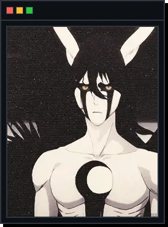
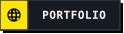

<table width="100%">
<tr>
<td width="65%" valign="top" align="center">
  <picture>
    <source media="(prefers-color-scheme: dark)" srcset="assets/typing-dark.svg">
    <source media="(prefers-color-scheme: light)" srcset="assets/typing-light.svg">
    
  </picture>
   
  <picture>
    <source media="(prefers-color-scheme: dark)" srcset="assets/stats-card-dark.svg">
    <source media="(prefers-color-scheme: light)" srcset="assets/stats-card-light.svg">
    
  </picture>
</td>
<td width="35%" valign="top" align="center">
  <picture>
    <source media="(prefers-color-scheme: dark)" srcset="assets/giphy-dark.webp">
    <source media="(prefers-color-scheme: light)" srcset="assets/giphy-light.webp">
    
  </picture>
</td>
</tr>
<tr>
<td colspan="2" align="center" style="padding: 14px 0;">
  
  <a href="https://www.linkedin.com/in/madhav9757" style="text-decoration: none; margin: 0 4px;">
    <picture>
      <source media="(prefers-color-scheme: dark)" srcset="assets/btn-linkedin-dark.svg">
      <source media="(prefers-color-scheme: light)" srcset="assets/btn-linkedin-light.svg">
      
    </picture>
  </a>
  <a href="https://leetcode.com/u/madhav9757/" style="text-decoration: none; margin: 0 4px;">
    <picture>
      <source media="(prefers-color-scheme: dark)" srcset="assets/btn-leetcode-dark.svg">
      <source media="(prefers-color-scheme: light)" srcset="assets/btn-leetcode-light.svg">
      
    </picture>
  </a>
  <a href="https://madhav.madhavsemwal9.workers.dev/" style="text-decoration: none; margin: 0 4px;">
    <picture>
      <source media="(prefers-color-scheme: dark)" srcset="assets/btn-portfolio-dark.svg">
      <source media="(prefers-color-scheme: light)" srcset="assets/btn-portfolio-light.svg">
      
    </picture>
  </a>
  <a href="https://github.com/madhav9757/madhav9757/blob/main/assets/resume.pdf" style="text-decoration: none; margin: 0 4px;">
    <picture>
      <source media="(prefers-color-scheme: dark)" srcset="assets/btn-resume-dark.svg">
      <source media="(prefers-color-scheme: light)" srcset="assets/btn-resume-light.svg">
      
    </picture>
  </a>
</td>
</tr>
</table>
