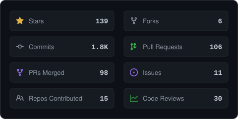
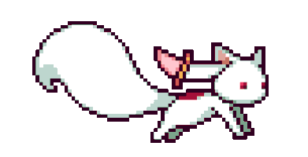

<table width="100%">
<tr>
<td width="65%" valign="top" align="center">
  <picture>
    <source media="(prefers-color-scheme: dark)" srcset="assets/typing-dark.svg">
    <source media="(prefers-color-scheme: light)" srcset="assets/typing-light.svg">
    
  </picture>
   
  <picture>
    <source media="(prefers-color-scheme: dark)" srcset="assets/stats-card-dark.svg">
    <source media="(prefers-color-scheme: light)" srcset="assets/stats-card-light.svg">
    
  </picture>
</td>
<td width="35%" valign="top" align="center">

</td>
</tr>
<tr>
<td colspan="2" align="center">
  &nbsp;
  
  
  
  
</td>
</tr>
</table>
